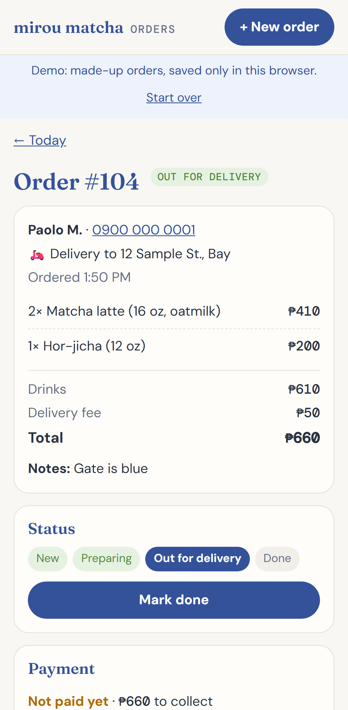

# Defect log: order tracker

Bugs found while building and testing the tracker. Each has a regression test that failed before the fix and passes after.

| ID | Summary | Severity | Found by | Status | Regression test |
| --- | --- | --- | --- | --- | --- |
| [T-BUG-001](#t-bug-001) | On Today, a status tap jumps the page to the top, so a quick double tap can open a different order | Minor | Automated test TT-10 | Fixed before release | TT-10 |

---

## T-BUG-001

**On Today, a status tap jumps the page to the top, so a quick double tap can open a different order**

| | |
| --- | --- |
| Severity / priority | Minor / High. Nothing is lost, but she would lose her place in the list after every tap, and a double tap can open the wrong order. |
| Found | 6 Oct 2026, by TT-10 ("a quick double tap moves an order only one step"), right after the backup section made the Today screen longer than a phone screen |
| Environment | Android and desktop (Chromium). The iPhone run did not hit it, because WebKit's double tap timing differs. |
| Status | Fixed before release |

**Steps to reproduce:** on a phone, scroll down Today to an order near the bottom, then double-tap its status button quickly.
**Expected:** the order moves one step, and the screen stays where it was.
**Actual:** the screen jumps to the top after the first tap, so the second tap lands on whatever is now under the finger. In the test it opened Order #104.

**Root cause:** after any change, the app redraws the screen. The redraw always scrolled to the top and moved focus to the heading, even when she was still on the same screen. That's only right when she moves to a different screen.

**Fix:** remember which screen is showing; scroll to the top and move focus only when the screen changes.

**Verification:** TT-10 failed on Android and desktop before the fix and passes on all 3 set-ups after, along with the other status tests (TT-08, TT-20).
